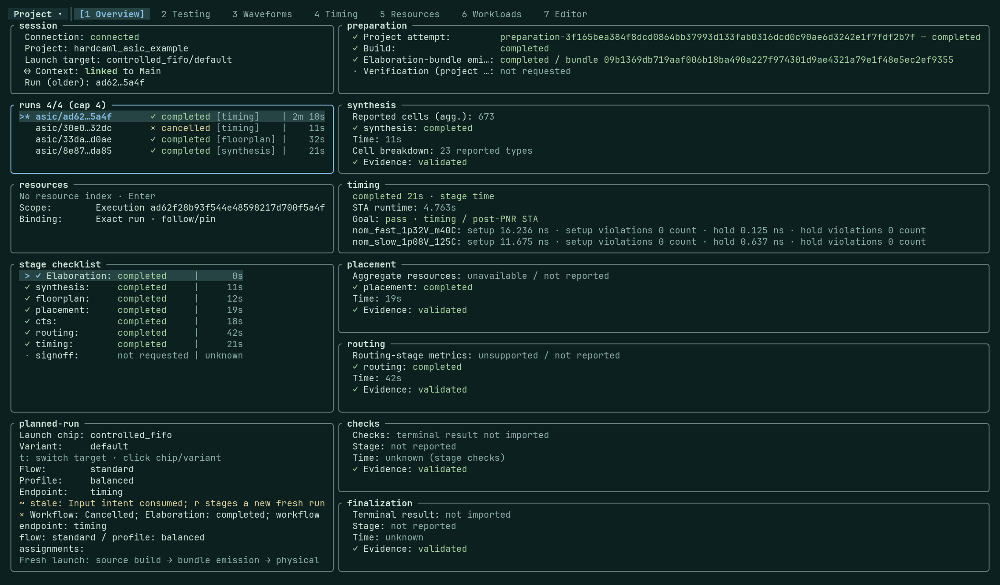

# Silver

Silver is a terminal workbench for hardware projects. It runs project builds and
simulation suites, launches configured ASIC flows, and lets you inspect
waveforms, synthesis results, timing paths, and other run evidence without
leaving the terminal.

[Install](#install-and-open-silver) · [Try the ASIC example](#try-the-asic-example) ·
[Documentation](docs/README.md)


*Inspecting a passing Controlled FIFO simulation from `hardcaml_asic_example`.*

## Install and open Silver

Pick one install route. Paste its command blocks in order in the same terminal,
and stop if a block reports an error.

### Prerequisites

- **Silver:** The prebuilt release targets Ubuntu 26.04 LTS on x86-64. A source
  installation automatically prepares a private OxCaml switch and Silver's
  dependencies, including Cobalt. See the [installation guide](docs/install.md).
- **Projects:** The machine running the Silver service needs the project's build
  environment: Dune for Hardcaml, or Bazel and the Classic Bluespec toolchain
  for the [Bluespec starter](docs/bluespec_classic.md). Simulation needs the project's configured
  simulation provider and any tools it invokes.
- **ASIC flows:** The service host also needs a compatible
  [hardcaml_asic provider](https://github.com/LeEmperor/hardcaml_asic#install-the-provider).
  The design may need the provider's OCaml libraries to build. Install the
  selected flow's PDK and EDA tools separately using the provider's provisioning
  instructions. They are not bundled with Silver.

### Install the Ubuntu binary

This route requires a published [GitHub Release](https://github.com/bopurtell/silver/releases).
If there isn't one yet, [build from source](#build-from-source) instead.

1. Install the Ubuntu runtime libraries and download tools:

   ```sh
   sudo apt update && sudo apt install -y curl jq libgmp10 zlib1g
   ```

2. Download and verify the latest binary archive, then enter the extracted directory:

   ```sh
   repo=https://github.com/bopurtell/silver
   tag=$(curl -fsSL https://api.github.com/repos/bopurtell/silver/releases/latest | jq -er '.tag_name') &&
     workdir=$(mktemp -d) && cd "$workdir" &&
     archive="silver-${tag}-linux-x86_64-ubuntu-26.04.tar.gz" &&
     curl -fsSLO "$repo/releases/download/$tag/$archive" &&
     curl -fsSLO "$repo/releases/download/$tag/SHA256SUMS" &&
     sha256sum --ignore-missing --check SHA256SUMS &&
     tar -xzf "$archive" && cd "${archive%.tar.gz}"
   ```

3. Install Silver for your user:

   ```sh
   ./install.sh --without-asic
   ```

   This skips the install-time ASIC provider check; you can still configure
   ASIC projects later.

### Build from source

The installer builds Silver in its own OxCaml environment, without modifying
your project's opam switch. The first build takes longer and uses additional
disk space; later installations reuse that environment.

1. On Ubuntu, install the host build tools:

   ```sh
   sudo apt update &&
     sudo apt install -y autoconf bubblewrap build-essential bzip2 ca-certificates curl git gzip \
       libgmp-dev libsqlite3-dev opam pkg-config python3 rsync unzip xz-utils zlib1g-dev
   ```

2. Clone and enter the repository. To build a published version instead, use
   the [source tarball download commands](docs/install.md#download-the-source-tarball)
   in place of this step.

   ```sh
   git clone https://github.com/bopurtell/silver.git && cd silver
   ```

3. Prepare the private switch, build and install Silver:

   ```sh
   ./install.sh --without-asic
   ```

   Developers who already have the dependencies in a compatible switch can
   [build using that existing switch](docs/install.md#use-an-existing-switch).

### Open a project

Starting from an empty directory? Launch Silver with `ag` and choose **New Project…**
to select a starter and destination. For headless creation of a [Classic
Bluespec design with Rust verification](docs/bluespec_classic.md), run
`ag init --bluespec`.

1. Add the default install directory to `PATH` and check the installed command.
   Keep the `export` line in your shell configuration if you want it in new terminals.

   ```sh
   export PATH="$HOME/.local/bin:$PATH"
   command -v ag
   ```

   If that resolves to The Silver Searcher instead of this workbench, use the
   installed absolute path (`$HOME/.local/bin/ag`) or adjust `PATH`.

2. In your project's normal build environment, open a terminal in the project directory:

   ```sh
   ag
   ```

3. Press **Space c c** to open the command palette. To quit from the
   workbench, press **q**, then **Enter** to confirm the default **Yes**.
   For jobs that should survive quitting, use
   [a persistent daemon](docs/project_workflows.md#attach-to-a-persistent-daemon).

## Try the ASIC example

The [hardcaml_asic_example](https://github.com/LeEmperor/hardcaml_asic_example)
repository contains a FIFO design with a `standard` flow and a `balanced` profile.
This walkthrough runs synthesis on that design; it does not require any saved runs.

1. In the example's [project OxCaml environment](docs/install.md#set-up-oxcaml), install
   `hardcaml_asic` if you don't already have a compatible provider:

   ```sh
   git clone https://github.com/LeEmperor/hardcaml_asic.git &&
     (cd hardcaml_asic && ./install.sh)
   ```

2. Clone and enter the example:

   ```sh
   git clone https://github.com/LeEmperor/hardcaml_asic_example.git && cd hardcaml_asic_example
   ```

3. Provision the tools and configure the project for synthesis. The
   [provider's bootstrap guide](https://github.com/LeEmperor/hardcaml_asic/blob/main/docs/guides/bootstrap.md)
   covers host requirements for the flow, including Docker and Nix.

   ```sh
   hardcaml-asic-flow provision --toolchain "$PWD/_flow_tools" &&
     python3 -B scripts/configure-synthesis.py
   ```

   To configure the example's simulation suites as well, see the
   [full example setup](docs/project_workflows.md#configure-the-asic-example-simulation-suites).
4. Launch Silver from the example directory, then open **Overview**.

   ```sh
   ag
   ```

5. In **Planned Run**, check **Launch chip**. The example's default is
   `controlled_fifo / default`; select it if another chip is active.
6. In the **Stage Checklist**, highlight **Synthesis** and press **Shift+R**
   to stage and launch it. To review the plan before starting, press **r**
   instead and follow the [stage checklist guide](docs/checklist_launch_workflow.md).



## Documentation

- [Project workflows](docs/project_workflows.md): opening, creating, editing,
  sharing, and attaching to a daemon.
- [Testing workspace](docs/testing_workspace.md) and the
  [Cyclesim counter](examples/cyclesim_counter/README.md): simulation without
  ASIC tools.
- [ASIC evidence](docs/asic_evidence_inspection.md),
  [synthesis inspection](docs/synthesis_inspection.md), and
  [timing investigation](docs/timing_workspace_usability.md).
- [Workspace layouts](docs/workspace_configuration.md) and
  [terminal controls](docs/terminal_controls.md).
- [Silver's own test suites](test/README.md).

Legacy `hardcaml-workbench` command aliases and configuration files remain readable.
The OCaml packages are now `silver`, `silver_provider` and `silver_web`;
provider source should use `Silver_provider` and be rebuilt against the new SDK.
