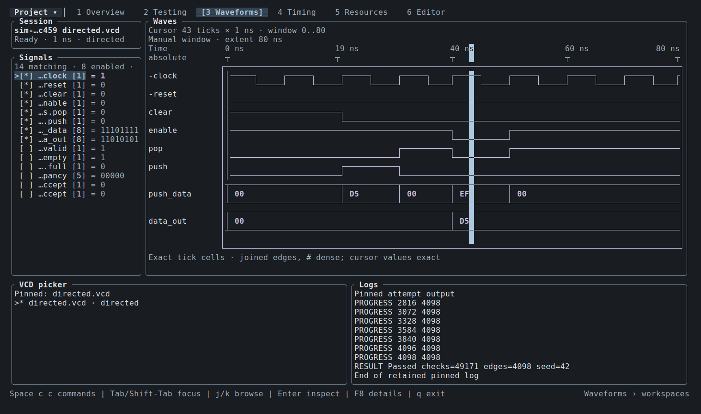

# Silver

Silver is a terminal workbench for Hardcaml projects. It runs Dune builds and
simulation suites, launches configured ASIC flows, and lets you inspect
waveforms, synthesis results, timing paths, and other run evidence without
leaving the terminal.

[Install](#install-and-open-silver) · [Try the ASIC example](#try-the-asic-example) ·
[Documentation](docs/README.md)



*Inspecting a passing Controlled FIFO simulation from `hardcaml_asic_example`.*

## Install and open Silver

### Prerequisites

- **Silver:** The prebuilt release targets Ubuntu 26.04 LTS on x86-64. A source
  build uses a compatible OxCaml opam switch and Silver's native dependencies,
  including Cobalt. See the [installation guide](docs/install.md).
- **Projects:** The machine running the Silver service needs Dune and the
  project's usual build environment. Simulation needs the project's configured
  simulation provider and any tools it invokes.
- **ASIC flows:** The service host also needs a compatible
  [hardcaml_asic provider](https://github.com/LeEmperor/hardcaml_asic#install-the-provider).
  The design may need the provider's OCaml libraries to build. Install the
  selected flow's PDK and EDA tools separately using the provider's provisioning
  instructions. They are not bundled with Silver.

### Install the Ubuntu binary

1. Download the Ubuntu 26.04 x86-64 archive and `SHA256SUMS` from
   [GitHub Releases](https://github.com/bopurtell/silver/releases).
2. Verify, extract, and install the archive as shown in the
   [binary installation instructions](docs/install.md#install-the-ubuntu-binary).

### Build from source

1. Download and extract the source tarball from
   [GitHub Releases](https://github.com/bopurtell/silver/releases), or clone this
   repository and enter the checkout.
2. Prepare the switch and dependencies under
   [Build from source](docs/install.md#build-from-source).
3. Run `./install.sh` from the source directory. Use `./install.sh --without-asic`
   if you don't need to check for an ASIC provider at install time.

### Open a project

1. Ensure the install prefix's `bin` directory is on `PATH`. For the default
   user install, run `export PATH="$HOME/.local/bin:$PATH"` and put that line in
   your shell configuration if needed.
2. In your project's normal build environment, open the Dune project:

   ```sh
   cd /path/to/your/project
   silver
   ```

3. Press **Space c c** to open the command palette. Press **q** from the
   workbench to quit. For jobs that should survive quitting, use
   [a persistent daemon](docs/project_workflows.md#attach-to-a-persistent-daemon).

## Try the ASIC example

The [hardcaml_asic_example](https://github.com/LeEmperor/hardcaml_asic_example)
repository contains a FIFO design with a `standard` flow and a `balanced` profile.
This walkthrough runs synthesis on that design; it does not require any saved runs.

1. In the example's OCaml environment, install `hardcaml_asic`. Clone and enter
   the example:

   ```sh
   git clone https://github.com/LeEmperor/hardcaml_asic_example.git
   cd hardcaml_asic_example
   ```

2. Provision the tools and configure the project for synthesis:

   ```sh
   hardcaml-asic-flow provision --toolchain "$PWD/_flow_tools"
   python3 -B scripts/configure-synthesis.py
   ```

   To configure the example's simulation suites as well, see the
   [full example setup](docs/project_workflows.md#configure-the-asic-example-simulation-suites).
3. Run `silver` and open **Overview**.
4. In **Planned Run**, check **Launch chip**. The example's default is
   `controlled_fifo / default`; select it if another chip is active.
5. In the **Stage Checklist**, highlight **Synthesis** and press **Shift+R**
   to stage and launch it. To review the plan before starting, press **r**
   instead and follow the [stage checklist guide](docs/checklist_launch_workflow.md).


## Documentation

- [Project workflows](docs/project_workflows.md): opening, creating, editing,
  sharing, and attaching to a daemon.
- [Testing workspace](docs/testing_workspace.md) and the
  [Cyclesim counter](examples/cyclesim_counter/README.md): simulation without
  ASIC tools.
- [ASIC evidence](docs/asic_evidence_inspection.md),
  [synthesis inspection](docs/synthesis_inspection.md), and
  [timing investigation](docs/timing_workspace_usability.md).
- [Workspace layouts](docs/workspace_configuration.md) and
  [terminal controls](docs/terminal_controls.md).
- [Silver's own test suites](test/README.md).

Existing `hardcaml-workbench` commands, `hardcaml_workbench*` OCaml packages and
modules, and legacy configuration names remain supported.
